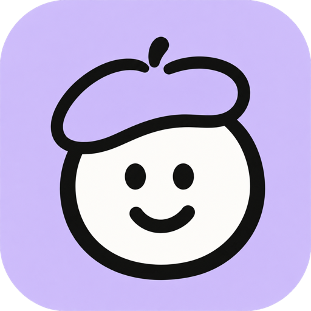

 

##  IQ Universe

<table align="center">
<tr>
<td align="center" width="280">
<a href="https://iq-dev-lab.github.io">
  
   
  <b>Dev&nbsp;Lab</b>
</a>
 
개발 연구소
 
 

</td>
<td align="center" width="280">
<a href="https://iq-ai-lab.github.io">
  
   
  <b>AI&nbsp;Lab</b>
</a>
 
AI·수학 연구소
 
 

</td>
<td align="center" width="280">
<a href="https://iq-phronesis-lab.github.io">
  
   
  <b>Phronesis&nbsp;Lab</b>
</a>
 
실천적 지혜 연구소
 
 

</td>
</tr>
<tr>
<td align="center" width="280">
<a href="https://iq-physis-lab.github.io">
  
   
  <b>Physis&nbsp;Lab</b>
</a>
 
물리 연구소
 
 

</td>
<td align="center" width="280">
<a href="https://iq-spiral-galaxy.github.io/">
  
   
  <b>Singulearn</b>
</a>
 
배움의 특이점
 
 

</td>
<td align="center" width="280">
<a href="https://iq-psyche-lab.github.io">
  
   
  <b>Psyche&nbsp;Lab</b>
</a>
 
마음·의식 연구소
 
 

</td>
</tr>
</table>

 

##  Details

&nbsp; &nbsp;<b>Dev Lab</b> &nbsp;—&nbsp; 개발 연구소

 

<table width="100%">
<tr>
<td colspan="2">
<strong>“Beyond the docs — into the essence of building software.”</strong>
  
공식 문서를 넘어 <strong>소프트웨어 개발 전반의 본질</strong>을 끝까지 파고드는 연구소.
</td>
</tr>
<tr>
<th scope="row" width="96" align="left" valign="top">탐구 영역</th>
<td>
<code>Backend</code>
<code>Frontend</code>
<code>iOS</code>
<code>Android</code>
<code>Architecture</code>
<code>Infrastructure</code>
<code>Database</code>
</td>
</tr>
<tr>
<th scope="row" width="96" align="left" valign="top">탐구 흐름</th>
<td>원리 → 트레이드오프 → 설계 → 구현 → 검증</td>
</tr>
<tr>
<th scope="row" width="96" align="left" valign="top">바로가기</th>
<td>

</td>
</tr>
</table>

&nbsp; &nbsp;<b>AI Lab</b> &nbsp;—&nbsp; AI·수학 연구소

 

<table width="100%">
<tr>
<td colspan="2">
<strong>“Prove, don't memorize — the math behind AI.”</strong>
  
수학적 증명으로 <strong>AI 알고리즘의 본질</strong>을 파고드는 연구소.
</td>
</tr>
<tr>
<th scope="row" width="96" align="left" valign="top">탐구 영역</th>
<td>
<code>RL</code>
<code>DL</code>
<code>CV</code>
<code>NLP</code>
<code>LLM</code>
<code>Generative</code>
<code>Audio</code>
<code>Math</code>
</td>
</tr>
<tr>
<th scope="row" width="96" align="left" valign="top">탐구 흐름</th>
<td>가정 → 보조정리 → 증명 → 구현 → 통찰</td>
</tr>
<tr>
<th scope="row" width="96" align="left" valign="top">바로가기</th>
<td>

</td>
</tr>
</table>

&nbsp; &nbsp;<b>Phronesis Lab</b> &nbsp;—&nbsp; 실천적 지혜 연구소

 

<table width="100%">
<tr>
<td colspan="2">
<strong>“Knowledge that doesn't change a decision is trivia.”</strong>
  
돈·사람·게임의 규칙을 <strong>메커니즘까지 해부하고, 판단 규칙으로 증류</strong>하는 실천적 지혜 연구소.
</td>
</tr>
<tr>
<th scope="row" width="96" align="left" valign="top">탐구 영역</th>
<td>
<code>Thinking</code>
<code>Money</code>
<code>People</code>
<code>Rules</code>
<code>World</code>
<code>Synthesis</code>
</td>
</tr>
<tr>
<th scope="row" width="96" align="left" valign="top">탐구 흐름</th>
<td>Explore → Mechanism → Stress-test → Distill → Document</td>
</tr>
<tr>
<th scope="row" width="96" align="left" valign="top">바로가기</th>
<td>

</td>
</tr>
</table>

&nbsp; &nbsp;<b>Physis Lab</b> &nbsp;—&nbsp; 물리 연구소

 

<table width="100%">
<tr>
<td colspan="2">
<strong>“Derive, don't accept — from the fewest principles, the widest world.”</strong>
  
공식을 외우는 대신, <strong>가장 적은 원리에서 가장 넓은 세계를 유도</strong>하는 물리 본질 연구소.
</td>
</tr>
<tr>
<th scope="row" width="96" align="left" valign="top">탐구 영역</th>
<td>
<code>Language</code>
<code>Classical</code>
<code>Statistical</code>
<code>Quantum</code>
<code>Relativity</code>
<code>Frontier</code>
<code>Synthesis</code>
</td>
</tr>
<tr>
<th scope="row" width="96" align="left" valign="top">탐구 흐름</th>
<td>제1원리 → 유도 → 반증 → 경계 → 창발</td>
</tr>
<tr>
<th scope="row" width="96" align="left" valign="top">바로가기</th>
<td>

</td>
</tr>
</table>

&nbsp; &nbsp;<b>Psyche Lab</b> &nbsp;—&nbsp; 마음·의식 연구소

 

<table width="100%">
<tr>
<td colspan="2">
<strong>“Explain it, don't explain it away.”</strong>
  
뉴런이라는 가장 단단한 바닥에서 <em>경험하는 나 자신</em>까지, <strong>마음을 한 층씩 쌓아 올려 설명</strong>하는 연구소. 설명이 끝내 닿지 못하는 곳을 지우지 않고 정직하게 표시합니다.
</td>
</tr>
<tr>
<th scope="row" width="96" align="left" valign="top">탐구 영역</th>
<td>
<code>Language of Mind</code>
<code>Neural Substrate</code>
<code>Cognition</code>
<code>Computational Mind</code>
<code>Consciousness</code>
<code>The Self</code>
<code>Synthesis</code>
</td>
</tr>
<tr>
<th scope="row" width="96" align="left" valign="top">탐구 흐름</th>
<td>Explore → Mechanism → Test → Connect → Document</td>
</tr>
<tr>
<th scope="row" width="96" align="left" valign="top">바로가기</th>
<td>

</td>
</tr>
</table>

&nbsp; &nbsp;<b>Singulearn</b> &nbsp;—&nbsp; 배움의 특이점

 

<table width="100%">
<tr>
<td colspan="2">
<strong>넓게 배우고, 깊이 연결합니다</strong>
  
궁금한 주제에서 시작해, <strong>질문하고 기록하며 이해를 쌓는 데스크톱 학습 앱</strong> 
같은 개념을 다시 만나며 이해를 깊게 하고, 서로 다른 분야의 지식을 연결합니다
</td>
</tr>
<tr>
<th scope="row" width="96" align="left" valign="top">학습 분야</th>
<td>
<code>수학·AI</code>
<code>판단·실천지</code>
<code>개발·시스템</code>
<code>물리·우주</code>
<code>뇌·마음</code>
</td>
</tr>
<tr>
<th scope="row" width="96" align="left" valign="top">학습 흐름</th>
<td>주제 선택 → 질문과 탐구 → 내 언어로 기록 → 다시 연결하며 학습</td>
</tr>
<tr>
<th scope="row" width="96" align="left" valign="top">바로가기</th>
<td>

</td>
</tr>
</table>

 

##  Projects

<table width="100%">
<tr>
<td colspan="2">
&nbsp; <a href="https://www.harudle.com"><b>하루들</b></a>
  
함께한 순간을 글로 기록하면 <strong>AI 네컷만화</strong>로 만들어 주는 서비스
  

</td>
</tr>
<tr>
<td width="50%" valign="top" nowrap>
&nbsp; <a href="https://world.harudle.com/"><b>하루들 월드</b></a>
  
하루들 세계관
  

</td>
<td width="50%" valign="top" nowrap>
&nbsp; <a href="https://campus.harudle.com/"><b>하루들 캠퍼스</b></a>
  
하루들 캠퍼스
  

</td>
</tr>
</table>

 

##  Blog

<table width="100%">
<tr>
<td colspan="2">
연구소의 지식을 압축해 발행하는 블로그
</td>
</tr>
<tr>
<th scope="row" width="96" align="left" valign="top">주제</th>
<td>
<code>개발</code>
<code>AI·수학</code>
<code>실천적 지혜</code>
<code>물리</code>
<code>마음·의식</code>
</td>
</tr>
<tr>
<th scope="row" width="96" align="left" valign="top">발행 방식</th>
<td>학습 기록 → 정리·압축 → 발행</td>
</tr>
<tr>
<th scope="row" width="96" align="left" valign="top">바로가기</th>
<td>

</td>
</tr>
</table>

 

##  Woowa Tech Course

<table width="100%">
<tr>
<td colspan="2">
우아한테크코스 8기 백엔드 기록
</td>
</tr>
<tr>
<th scope="row" width="96" align="left" valign="top">기록 대상</th>
<td><code>우아한테크코스 8기</code> <code>Backend</code></td>
</tr>
<tr>
<th scope="row" width="96" align="left" valign="top">기록 내용</th>
<td><code>OOP</code> <code>Java</code> <code>Spring</code> <code>Infra</code> <code>Soft Skills</code></td>
</tr>
<tr>
<th scope="row" width="96" align="left" valign="top">바로가기</th>
<td>

</td>
</tr>
</table>

 

##  Achievements

&nbsp; &nbsp;<b>Baekjoon Online Judge</b>

 

&nbsp; &nbsp;<b>Collegiate Programming Contest</b>

 

<table>
<tr>
<td align="center" valign="top" width="50%">

  
<b>SCPC 2025</b>
 
Samsung Collegiate Programming Cup
  

 

  

</td>
<td align="center" valign="top" width="50%">

  
<b>ACPC 2025</b>
 
AWS × Codetree Programming Contest
  

 

  

</td>
</tr>
</table>

&nbsp; &nbsp;<b>Certifications</b>

 

<table>
<thead>
<tr>
<th align="left">자격증</th>
<th align="center">취득일</th>
<th align="center">등급</th>
<th align="left">발급 기관</th>
</tr>
</thead>
<tbody>
<tr>
<td> &nbsp;<b>정보처리기사</b> Engineer Information Processing</td>
<td align="center"><code>2024.09.10</code></td>
<td align="center">—</td>
<td>한국산업인력공단</td>
</tr>
<tr>
<td> &nbsp;<b>빅데이터분석기사</b> Engineer Big Data Analysis</td>
<td align="center"><code>2025.07.11</code></td>
<td align="center">—</td>
<td>한국데이터산업진흥원</td>
</tr>
<tr>
<td> &nbsp;<b>SQLD</b> SQL Developer</td>
<td align="center"><code>2024.09.20</code></td>
<td align="center">—</td>
<td>한국데이터산업진흥원</td>
</tr>
<tr>
<td> &nbsp;<b>ADsP</b> Data Analytics Semi-Professional</td>
<td align="center"><code>2024.11.29</code></td>
<td align="center">—</td>
<td>한국데이터산업진흥원</td>
</tr>
<tr>
<td> &nbsp;<b>TOPCIT</b> Test of Practical Competency in IT</td>
<td align="center"><code>2025.05.24</code></td>
<td align="center"></td>
<td>정보통신기획평가원</td>
</tr>
</tbody>
</table>

 

